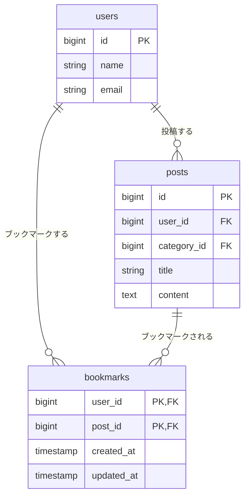
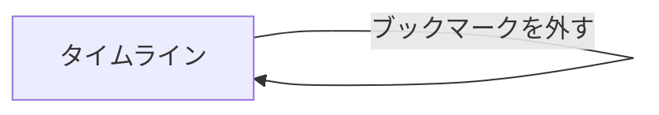

# ブックマーク機能 設計書

Issue: https://github.com/basstuba/post-app-practice/issues/11

## 概要

今のタイムラインには、あとで見返したいポストに印を付ける手段がない。ポストにブックマークを付け外しできるようにして、印を残せるようにする。ブックマークはそのユーザー本人だけのもので、他人のブックマークは見えない。

- タイムラインの各ポストに、しおりの形のアイコンのボタンを足す。付いていなければ枠線だけの形、付いていれば青系の色で塗りつぶした形になる
- 新しい画面は作らない。ブックマークを使った探し方(検索など)は、別のIssueで扱うので今回はやらない
- ブックマークの数は出さない。他のユーザーが付けたかどうかも、画面のどこにも出さない
- 付け外しには、ログインが必要

### 決めたこと

| 項目 | 内容 |
| :--- | :--- |
| 入口 | タイムライン(`posts.index`)の各ポストの操作の行に、ブックマークのボタンを足す。自分・他人どちらのポストにも出す |
| 見た目 | 文字のボタンにせず、しおりの形のアイコンにする。付いていなければ枠線だけ、付いていれば青系の色(`#2F5AA8`)で塗りつぶす。アイコンは Blade にインラインの SVG で書く |
| アイコンの説明 | 画面に文字は出さない。読み上げソフトやマウスを載せたときのために、付いていなければ「ブックマークする」、付いていれば「ブックマークを外す」を `aria-label` と `title` に入れる |
| 付け外しできる人 | ログイン済みのユーザーなら誰でも。ポストの持ち主かどうかは関係ない |
| 付いた状態 | ユーザーごとに持つ。同じユーザーが同じポストに付けられるブックマークは1つまで |
| 他人のブックマーク | 取得もしない。タイムラインで調べるのは「ログイン中のユーザーが付けたか」だけにする |
| 押したあと | `posts.index` にリダイレクトする(いいねと同じ。先頭に戻る) |
| 二重に付ける・付いていないのに外す | どちらもエラーにせず、何も変えずにタイムラインへ戻る(`insertOrIgnore` と `detach` の動きに任せる) |
| ポストが削除されたとき | そのポストのブックマークも一緒に消える |
| ユーザーが削除されたとき | そのユーザーのブックマークも一緒に消える |
| 認可のやり方 | ポリシーは作らない。持ち主の判定が無く、`auth` ミドルウェアのグループに入れるだけで足りるため。付け外しの対象は、ログイン中のユーザー自身のブックマークだけ |
| 入力チェック | 入力欄が無いので、入力チェックは足さない |

### 付随して行うこと(機能の範囲外)

付随して行うことは無い。言語設定・`lang/ja/validation.php` も変えない。

## 受け入れ条件

- [ ] ブックマークを押すと、印が分かるように見た目が変わる
- [ ] ログインしているユーザーが付けたブックマークだけが表示される(他人のブックマークは表示されない)

## 変えないもの

- タイムライン(`posts.index`)の今の動き。全ポストを新しい順(`latest()`)に、ページ分けなしで並べる動き、一覧に出る項目(投稿者・日時・「編集済み」・トピック・タイトル・本文)・並び順・リンク先は、そのままにする。足してよいのはブックマークのボタンだけ
- 他人のポストに編集・削除が出ない動きと、編集・削除の認可(`PostPolicy` は触らない)
- いいね・リプライ(「返信」リンクを含む)・ポスト作成・編集・削除・「編集済み」の目印
- ポスト詳細画面(`posts.show`)。ブックマークのボタンは置かない
- 本文 140 字・タイトル 255 字の制限
- 既存のテーブル(`users` / `posts` / `categories` / `replies` / `likes`)の列。ブックマークとの関係は、新しい `bookmarks` 側に持たせる
- 既存のシーダーデータ(ユーザー・トピック・ポスト)。`DatabaseSeeder` は変えない。動作確認のときは、画面からブックマークを付ける
- 認証が必要なルートは、これまでどおり `auth` ミドルウェアのグループに入れる

言語設定の変更など、要件の範囲外で修正が必要になる場所は無い。

## 増えるテーブル

`bookmarks`(ブックマーク)を1つ足す。`likes` と同じ、ユーザーとポストを結ぶ中間テーブルにする。

### ER図

`users` と `posts` は、今ある列のうち関係の説明に必要なものだけを描いている。

### bookmarks(ブックマーク)

| カラム名 | データ型 | 制約 | 説明 |
| :------- | :------- | :--- | :--- |
| user_id | BIGINT | PRIMARY KEY(複合), FOREIGN KEY | ブックマークした人。`users.id` を参照し、ユーザーの削除と一緒に消える |
| post_id | BIGINT | PRIMARY KEY(複合), FOREIGN KEY | ブックマークされたポスト。`posts.id` を参照し、ポストの削除と一緒に消える |
| created_at | TIMESTAMP | - | 作成日時 |
| updated_at | TIMESTAMP | - | 更新日時 |

- `id` 列は持たず、`user_id` と `post_id` の組を主キーにする。同じユーザーが同じポストに付けられるブックマークを1つまでにするため(`likes` と同じ作り)
- 付けた日時(`created_at`)は持つが、今回の画面では使わない

### 追加・変更されるクラス(コードはまだ書かない)

| 種類 | 名前 | 役割 |
| :--- | :--- | :--- |
| マイグレーション | `create_bookmarks_table`(新規) | `bookmarks` テーブルを作る |
| モデル | `Post`(変更) | `bookmarkedBy()` を `belongsToMany`(中間テーブル `bookmarks`)で足す |
| コントローラー | `BookmarkController`(新規) | ブックマークを付ける(`store`)と外す(`destroy`)。`store` は1回の `insertOrIgnore` で重複を無視する |
| コントローラー | `PostController`(変更) | `index` で、ログイン中のユーザーが付けたかどうか(`bookmarked_by_me`)を `withExists` で一緒に取得する |
| ビュー | `posts/index.blade.php`(変更) | 操作の行にブックマークのボタン(SVG)を足す |
| ファクトリー | 足さない | 準備は `Post::factory()` と `bookmarkedBy()->attach()` などで足りる |

## 増える画面

新しい画面は無い。

### 既存画面の変更(新しい画面ではない)

| 画面 | 変更 |
| :--- | :--- |
| タイムライン(`posts.index`) | 各ポストの操作の行(返信・いいね・編集・削除と同じ行)に、ブックマークのボタンを足す。位置は「いいね」の右。ほかは変えない |

ボタンの中身:

| 状態 | 見た目 | `aria-label` / `title` | 送信先 |
| :--- | :--- | :--- | :--- |
| 付いていない | 枠線だけのしおり(`fill="none"`、色は他の操作と同じ灰色) | ブックマークする | `POST /posts/{post}/bookmark` |
| 付いている | 青系(`#2F5AA8`)で塗りつぶしたしおり。ボタンに `bookmarked` のクラスを付ける | ブックマークを外す | `DELETE /posts/{post}/bookmark` |

### 画面遷移

### ルート

| 操作 | メソッドとURL | 名前 | 認可 |
| :--- | :------------ | :--- | :--- |
| ブックマークを付ける | POST /posts/{post}/bookmark | `bookmarks.store` | ログイン済みなら誰でも |
| ブックマークを外す | DELETE /posts/{post}/bookmark | `bookmarks.destroy` | ログイン済みなら誰でも(外せるのは自分のブックマークだけ) |

## 入力チェックとメッセージ一覧

### 入力チェック

入力欄が無いので、入力チェックは無い。

- 存在しないポストを指定した場合(`{post}` が見つからない)は、入力チェックではなく404になる
- 付け外しは、ログインしていなければ、ログイン画面へ送る

### メッセージ一覧

| 画面 | でる場面 | 区分 | メッセージ |
| :--- | :------- | :--- | :--------- |
| タイムライン | 存在しないポストにブックマークを付け外ししようとした | エラー(404画面) | Laravel 既定の404画面を出す(文言は英語のまま) |

- 画面に出す新しい文言は無い。`aria-label` と `title` の「ブックマークする」「ブックマークを外す」は、アイコンの説明であり、画面には表示されない
- 成功したときのメッセージは出さない。アイコンの見た目が変わること自体が結果の確認になる

## テスト観点

Feature テストで確認する(`tests/Feature/BookmarkTest.php`)。DB を使うので `RefreshDatabase` を使う。データは `UserFactory`・`PostFactory`・`CategoryFactory` で作る。

### 受け入れ条件に対応するもの

| # | 観点 | 期待する結果 |
| :-- | :--- | :----------- |
| 1 | ブックマークの付いていないポストのボタンを押す | `bookmarks` に1件増え、`posts.index` に戻る。タイムラインで、そのポストのボタンが「ブックマークを外す」の `aria-label` と `bookmarked` のクラスになる |
| 2 | ブックマークの付いているポストのボタンを押す | `bookmarks` から1件減り、タイムラインで「ブックマークする」の表示に戻る |
| 3 | 他のユーザーがブックマークしたポストを、自分が開く | 自分が付けていないポストは「ブックマークする」のまま。他のユーザーが付けた印は出ない |
| 4 | 自分がブックマークしたポストを、別のユーザーでログインし直して開く | 別のユーザーの画面では、そのポストは付いていない表示になる |
| 5 | 自分が複数のポストのうち一部だけをブックマークした状態でタイムラインを開く | 付けたポストだけが「付いている」表示で、ほかは付いていない表示になる |

### 境界・認可・その他

| # | 観点 | 期待する結果 |
| :-- | :--- | :----------- |
| 6 | 同じポストに、続けて2回「付ける」を送る | エラーにならず、`bookmarks` は1件のまま |
| 7 | 付いていないポストに「外す」を送る | エラーにならず、`bookmarks` の件数は変わらない |
| 8 | 他のユーザーがブックマークしたポストに、自分が「外す」を送る | 他のユーザーのブックマークは残る(消えるのは自分の分だけ) |
| 9 | 自分のポストにブックマークを付ける | 付けられる |
| 10 | タイムラインを開く | ブックマークの数が画面に出ない |
| 11 | 未ログインで、付ける・外すのそれぞれにアクセスする | ログイン画面(`route('login')`)へ送られ、`bookmarks` は増えも減りもしない |
| 12 | 存在しないポストに、付ける・外すのそれぞれを送る | 404になり、`bookmarks` は変わらない |
| 13 | ポストを削除する | そのポストのブックマークも一緒に消える |
| 14 | ユーザーを削除する | そのユーザーのブックマークも一緒に消える |
| 15 | 同じユーザーと同じポストの組を、直接2回 INSERT する | 一意制約違反になる(`LikeTest` と同じ確認) |

### 既存の動きが変わっていないことの確認

| # | 観点 | 期待する結果 |
| :-- | :--- | :----------- |
| 16 | ブックマークを付けたあとのタイムライン | 全ポストが、今までどおり新しい順に並ぶ。投稿者・日時・トピック・タイトル・本文・「返信」リンクのリンク先は変わらない |
| 17 | ブックマークを付けたあとのタイムライン | ページ分けはされず、全件が出る |
| 18 | 他人のポストの編集・削除 | 今までどおり、編集・削除ボタンは出ず、URL を直接叩いても403になる |
| 19 | いいねとブックマークを同じポストに付ける | お互いに影響しない(いいねの数と状態はそのまま) |
| 20 | ポスト詳細画面(`posts.show`)を開く | ブックマークのボタンが出ない |
| 21 | 既存のテスト(`LikeTest`・`ReplyTest`・`PostContentLimitTest` など)をすべて流す | すべて通る |
