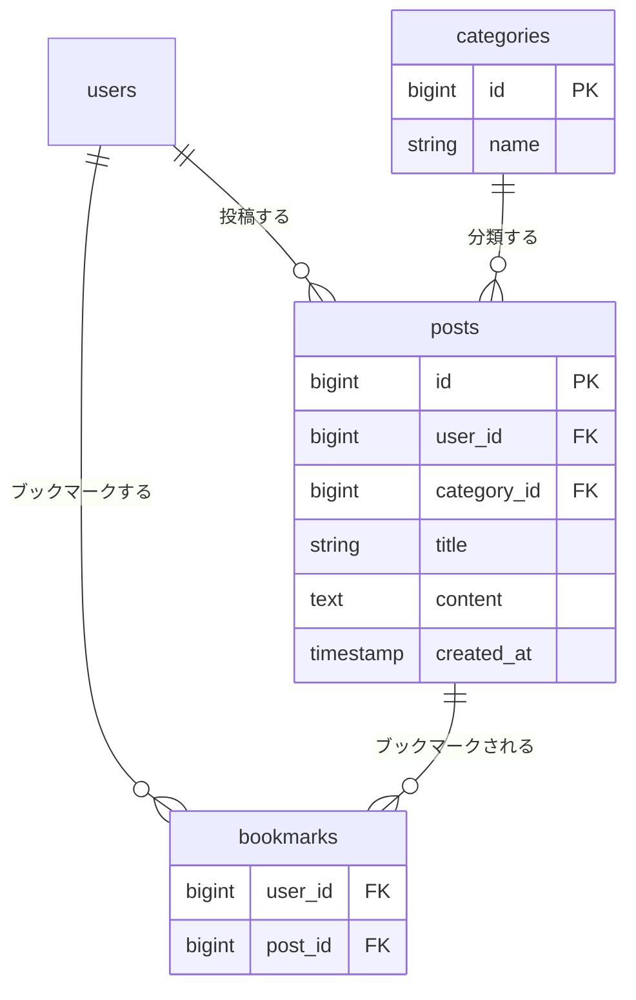

# 検索機能 設計書

Issue: https://github.com/basstuba/post-app-practice/issues/12

## 概要

ポストにタグ（#10）やブックマーク（#11）を付けられても、それを手がかりに探す手段がなく、タイムラインは全ポストが新しい順に並ぶだけである。タイムラインの上部に検索欄を足し、キーワード・トピック・自分のブックマークでポストを絞り込めるようにする。

- 新しい画面は作らない。タイムライン（`posts.index`）に検索欄を足し、同じ URL に `?q=…&category=…&bookmarked=1` を付けて絞り込む（GET）
- テーブルは増やさず、データも書き換えない。表示するポストを絞るだけ
- #10 のタグ絞り込み（`?tag=`）は作り直さず、今回の条件と AND で重ねて使えるようにする
- このイシューは #10・#11 の実装が済んでいることを前提にする

### 決めたこと

| 項目 | 内容 |
| :--- | :--- |
| 入口 | タイムラインの上部（ヘッダーの下、ポスト一覧の前）に検索欄を置く。ヘッダー（スクロールしても残る部分）には入れない。ポストが 0 件のときも検索欄は出す |
| 検索欄の部品 | キーワードの入力欄、トピックの選択欄（「すべてのトピック」＋既存のトピック）、「ブックマークしたポストだけ」のチェックボックス、「検索」ボタン、「条件をクリア」のリンク |
| 検索できる人 | ログインしているユーザーのみ。`posts.index` は既存どおり `auth` グループに入っているので、未ログインはログイン画面へ送られる |
| キーワードの対象 | ポストの**タイトルと本文**。どちらかに含まれていれば該当。投稿者名・トピック名・タグ名・リプライの本文は対象にしない |
| キーワードの一致 | 入力全体を 1 つの語として部分一致。英字の大文字小文字は区別しない（MySQL の既定の照合順序に任せる）。`%` `_` `\` は特別扱いせず、ふつうの文字として探す |
| キーワードの空白 | 前後の空白（半角・全角）を取り除いてから使う。取り除いた結果が空なら、キーワードでは絞り込まない。100 字の数え方も取り除いた後の文字数。不正な UTF-8（`?q=%FF` など）は、取り除きも絞り込みもせず入力エラーにする |
| トピックの絞り込み | 1 つだけ選べる。「すべてのトピック」（値は空）ならトピックでは絞り込まない。トピックは既存の `categories` をそのまま使い、増やさない |
| ブックマークの絞り込み | チェックを入れる（`bookmarked=1`）と、ログインしているユーザー本人が付けたブックマークのポストだけにする。他人のブックマークは対象にならず、画面にも出ない |
| 組み合わせ | キーワード・トピック・ブックマーク・タグ（`?tag=`）はすべて AND。検索欄の「検索」を押したとき、いま選んでいるタグは隠し項目で引き継ぐ |
| 結果の並び | 新しい順（`latest()`）、ページ分けなし。各ポストの表示は絞り込みなしの一覧と同じ |
| 条件の見せ方 | 検索後も、検索欄にキーワード・選んだトピック・チェックの状態が残る。エラーで戻ったときは、送った内容の通りに残す（チェックを外して送ったなら、外れたまま） |
| 「条件をクリア」 | 押すと条件なしの `posts.index` に戻る（`tag` も外れる）。キーワード・トピック・ブックマーク・タグのどれかが付いているときだけ出す |
| 該当なしの文言 | `q`・`category`・`bookmarked` のどれかが付いていて 0 件のときは「条件に合うポストはありません。」。条件がなくて 0 件のときは「まだポストがありません。」。`?tag=` だけで 0 件のときは、#10 の「このタグのポストはありません。」のまま |
| 存在しないトピック | `category` に存在しない id や数値以外（配列を含む）を指定したら 404（#10 の `?tag=` と同じ）。空文字は「指定なし」として扱う |
| 入力チェックの置き場所 | `PostController::index` の中の `$request->validate()`（FormRequest は使わない）。`category` は先に調べて 404 にし、そのあとで `q` と `bookmarked` を調べる。入力エラーの戻り先は、直前のページではなく、いつも `posts.index`（選んでいるタグだけ引き継ぐ） |
| 押したあと | いいね・ブックマークのボタンを押したあとの行き先は今までどおり `posts.index` で、検索条件は引き継がない（変えない） |

## 受け入れ条件

- [ ] タイムラインでキーワードを入れて検索すると、タイトルか本文にそのキーワードを含むポストだけが並ぶ
- [ ] トピックを 1 つ選んで検索すると、そのトピックのポストだけが並ぶ
- [ ] 「ブックマークしたポストだけ」を選んで検索すると、ログインしているユーザーが自分でブックマークしたポストだけが並ぶ
- [ ] キーワード・トピック・ブックマークのうち複数を指定すると、指定したすべてに合うポストだけが並ぶ
- [ ] 条件に合うポストが 0 件のときは、「条件に合うポストはありません。」と出る
- [ ] 検索条件を空にして検索するか「条件をクリア」を押すと、これまで通りの全ポストの一覧に戻る

## 変えないもの

- タイムラインの一覧（検索条件なし）: 全ポストを新しい順（`latest()`）に、ページ分けなしで並べる動き。一覧に出る項目・並び順・リンク先もそのまま。検索欄を足すだけ
- 絞り込みは、`q`・`category`・`bookmarked` のどれかを付けたときだけ働く
- #10 のタグ絞り込みの動き（`?tag=` 単体、存在しないタグは 404、0 件のときの文言）
- #11 のブックマークの付け外しと、他人のブックマークが見えない動き
- ポストの作成・編集でのトピックの選び方（必須）と、トピックの用意
- いいね・リプライ・ポスト作成・編集・削除・「編集済み」の目印、他人のポストに編集・削除が出ない動き
- 本文 140 字・タイトル 255 字の制限
- 既存のシーダーデータ（ユーザー・トピック・ポスト）。シーダーも増やさない
- 認証が必要なルートは、これまでどおり `auth` ミドルウェアのグループに入れる

### 言語設定による変化

`lang/ja/validation.php` に `in`・`utf8` の訳と項目名（`q`・`bookmarked`・`category`）を足す。今ある訳と項目名は変えないので、ほかの画面の文言は変わらない。

## 増えるテーブル

テーブルは増えない。検索は、すでにあるテーブルを読んで絞り込むだけ。

### ER図

検索が使う関係だけを描く。`bookmarks` は #11 で作られるテーブルで、名前は仮。タグは今回の検索では新しく使わない（`?tag=` は #10 の動きのまま）ので省いた。

### テーブルに入れる値

増えるテーブルも、書き込む値も無い。検索条件は URL に載るだけで、保存しない。

| 条件 | 見る列 | 絞り方 |
| :--- | :----- | :----- |
| キーワード（`q`） | `posts.title` と `posts.content` | どちらかが部分一致 |
| トピック（`category`） | `posts.category_id` | 一致 |
| ブックマーク（`bookmarked=1`） | #11 の `bookmarks`（仮） | ログイン中のユーザーが付けたものがあるポスト |

### 追加・変更されるクラス(コードはまだ書かない)

| 種類 | 名前 | 役割 |
| :--- | :--- | :--- |
| コントローラー | `PostController`（変更） | `index` で `category` の確認（404）、`q`・`bookmarked` の入力チェック、条件の組み立てを行う。検索欄に渡すトピック一覧も取る。キーワードの前後の空白取り除きと、`%` `_` `\` のエスケープは、このコントローラーの中の非公開メソッドにまとめる。入力エラーは `posts.index` へ戻す |
| ビュー | `posts/index.blade.php`（変更） | 検索欄を足す。0 件のときの文言の出し分けを足す |
| 言語ファイル | `lang/ja/validation.php`（変更） | `in`・`utf8` の訳と、項目名 `q`・`bookmarked`・`category` を足す |
| モデル | `Post`（変更なし） | #10・#11 で足されるリレーション（ブックマークしたユーザー）を使う。名前は #11 の実装に合わせる |
| テスト | `tests/Feature/PostSearchTest.php`（新規） | 下の「テスト観点」 |

## 増える画面

### 画面ごと

新しい画面は無い。

### 既存画面の変更(新しい画面ではない)

| 画面 | 変更 |
| :--- | :--- |
| タイムライン（`posts.index`） | ヘッダーの下に検索欄を足す。0 件のときの文言を条件の有無で出し分ける。ポストの並び・各ポストの表示・リンク先は変えない |

検索欄の項目:

| 場所 | 項目 | 内容 |
| :--- | :--- | :--- |
| 検索欄 | キーワード | 1 行の入力欄。100 字以内。ラベル「キーワード」。エラーのときと検索後は入力した内容を残す |
| 検索欄 | トピック | 選択欄。先頭が「すべてのトピック」（値は空）、続いて既存のトピックを id 順。選んだものを残す |
| 検索欄 | ブックマーク | チェックボックス「ブックマークしたポストだけ」。検索後は状態を残す |
| 検索欄 | タグ | 隠し項目。`?tag=` が付いているときだけ、その値を入れて引き継ぐ |
| 検索欄 | 検索ボタン | 押すと `GET /posts` に条件を付けて送る |
| 検索欄 | 条件をクリア | 条件なしの `posts.index` へのリンク。条件が付いているときだけ出す |
| 検索欄 | エラー表示 | 該当する入力欄の下に出す。既存の画面と同じく赤字 |

### 画面遷移

### ルート

新しいルートは無い。既存のルートに、次のクエリを受けられるようにする。

| 操作 | メソッドとURL | 名前 | 認可 |
| :--- | :------------ | :--- | :--- |
| 検索する | GET /posts?q=…&category=…&bookmarked=1（`tag=…` は #10） | `posts.index` | ログイン済みなら誰でも。ブックマークの絞り込みは本人のぶんだけ |

## 入力チェックとメッセージ一覧

### 入力チェック

| 項目 | 必須 | 規則 | 備考 |
| :--- | :--- | :--- | :--- |
| `q`（キーワード） | 任意 | 文字列・正しい UTF-8・100 字以内 | 前後の空白を取り除いたあとの文字数で数える。`string` に失敗したら以降の規則は見ない（配列のときに訳の無い `max` の文言が出ないようにする）。配列を送られても 500 にならない。不正な UTF-8（`?q=%FF` など）は空白の取り除きを行わずにエラーにする（そのまま通すと、全件の一覧が出てしまう） |
| `bookmarked` | 任意 | `1` のみ | `0` や `abc`、配列はエラー。チェックを外したときは送られない |
| `category` | 任意 | 存在するトピックの id | 入力チェックではなく 404 で扱う。空文字は「指定なし」 |

- 入力チェックのエラーのとき、検索欄にはエラーと入力した内容を残して `posts.index` に戻る。ポストの一覧は出さない
- 戻り先は、リクエストの Referer（直前のページ）に関わらず `posts.index` にする。`?tag=` が付いていたときだけ、そのタグを付けて戻る
- エラーで戻ったとき、チェックボックスは送信した内容の通りにする。チェックを外すと `bookmarked` は送られないので、「送られていない＝外した」として扱い、戻り先の URL にあった値を使わない
- 確認の順は、先に `category`（404）、次に `q`・`bookmarked`（入力エラー）。両方が不正なときは 404 になる

### メッセージ一覧

| でる場面 | 区分 | メッセージ |
| :------- | :--- | :--------- |
| キーワードが 101 字以上 | エラー | キーワードは100文字以内で入力してください。 |
| キーワードに配列が送られた | エラー | キーワードは文字列で入力してください。 |
| キーワードが不正な UTF-8 | エラー | キーワードに使えない文字が含まれています。 |
| `bookmarked` に `1` 以外が送られた | エラー | 選択されたブックマークの絞り込みは正しくありません。 |
| 条件を付けて 0 件 | 案内 | 条件に合うポストはありません。 |
| 条件なしで 0 件 | 案内 | まだポストがありません。（今のまま） |
| `?tag=` だけで 0 件 | 案内 | このタグのポストはありません。（#10 のまま） |
| 存在しないトピックを指定した | エラー（404 画面） | Laravel 既定の 404 画面（文言は英語のまま） |

- メッセージは `lang/ja/validation.php` の訳（`max.string`・`string`・`in`・`utf8`）と項目名（`q` → キーワード、`bookmarked` → ブックマークの絞り込み）から作る。コントローラーでの個別指定はしない
- 404 の画面は、`ja.json` が無いので英語のまま。訳すかどうかは別のイシューで決める
- 成功したときのメッセージは出さない。一覧が絞られること自体が結果の確認になる

## テスト観点

Feature テスト（`PostSearchTest`）で確認する。DB を使うので `RefreshDatabase` を使い、データは Factory で作る。順序のテストでは `created_at` を明示する。

### 受け入れ条件に対応するもの

| # | 観点 | 期待する結果 |
| :-- | :--- | :----------- |
| 1 | タイトルだけにキーワードを含むポストと、本文だけに含むポストと、どちらにも含まないポストがある状態で検索する | 前の 2 つだけが並び、含まないポストは出ない |
| 2 | トピックを 1 つ選んで検索する | そのトピックのポストだけが並ぶ |
| 3 | `bookmarked=1` で検索する（自分がブックマークしたポスト、他人だけがブックマークしたポスト、誰もしていないポストがある） | 自分がブックマークしたポストだけが並ぶ |
| 4 | キーワード＋トピック、キーワード＋ブックマーク、トピック＋ブックマーク、3 つ全部を指定する | それぞれ、指定したすべてに合うポストだけが並ぶ |
| 5 | 合うポストが無い条件で検索する | 「条件に合うポストはありません。」が出る |
| 6 | 条件を空にして検索する（`?q=&category=`） | 全ポストが新しい順に並ぶ。「条件をクリア」は出ない |
| 7 | 条件が付いているときの「条件をクリア」 | リンクが出て、先は条件なしの `posts.index`。そこでは全ポストが並ぶ |

### 境界・認可・その他

| # | 観点 | 期待する結果 |
| :-- | :--- | :----------- |
| 8 | キーワードがちょうど 100 字 / 101 字 | 100 字は検索できる。101 字はエラー（「キーワードは100文字以内で入力してください。」）になり、一覧は出ない |
| 9 | キーワードが半角空白だけ / 全角空白だけ | 絞り込まず、全ポストが並ぶ |
| 10 | キーワードの前後に空白がある | 取り除いた語で検索される |
| 11 | 英字の大文字小文字違い（`LARAVEL` で `Laravel` を探す） | 該当する |
| 12 | キーワードに `%` / `_` / `\` を入れる | ふつうの文字として探す。`%` で全件が当たることはない |
| 13 | 投稿者名・トピック名・リプライの本文にだけ含まれる語で検索する | 出ない |
| 14 | 検索結果の並び | 新しい順 |
| 15 | 検索後の検索欄 | キーワード・選んだトピック・チェックの状態が残る |
| 16 | `q` に配列を送る | 500 にならず、「キーワードは文字列で入力してください。」が出る。翻訳キー（`validation.max.array` など）がそのまま出ない |
| 17 | `bookmarked` に `0` / `abc` / 配列を送る | 500 にならず、「選択されたブックマークの絞り込みは正しくありません。」が出る |
| 18 | エラーで戻ったとき（`from()` で戻り先を指定） | 入力したキーワードとエラーメッセージが画面に残る |
| 18-1 | 戻り先の指定が無い / `posts.index` 以外（`posts.create` など）/ 不正な値が付いた `posts.index` から入力エラーにする | いずれも `posts.index`（検索欄のある画面）に戻る。`?tag=` が付いていれば、そのタグを付けて戻る |
| 18-2 | 戻り先が `?bookmarked=1` の画面で、チェックを外して（`bookmarked` を送らずに）エラーにする | 戻った画面のチェックは外れている。チェックを付けて送ったときは付いている |
| 18-3 | `q` に不正な UTF-8（`?q=%FF`、前後に空白を付けたもの）を送る | 500 にも全件表示にもならず、「キーワードに使えない文字が含まれています。」が出て、一覧は出ない |
| 19 | `category` に存在しない id / 数値以外 / 配列 | 404 になる |
| 20 | `category` に空文字を送る | 絞り込まず、全ポストが並ぶ |
| 21 | `?tag=` が付いた状態で検索する | 検索欄の隠し項目で引き継がれ、タグ＋検索条件の AND で絞られる |
| 22 | 結果に出る他人のポスト | 編集・削除は出ない。いいね・ブックマークのボタンは一覧と同じに出る |
| 23 | 他のユーザーでログインして同じ条件で検索する | ブックマークの絞り込みは、そのユーザー自身のブックマークだけが対象になる |
| 24 | 未ログインで `posts.index?q=…` を開く | ログイン画面へ送られる |
| 25 | 検索を実行したあと | ポスト・ブックマークなどの件数が変わっていない |

### 既存の動きが変わっていないことの確認

| # | 観点 | 期待する結果 |
| :-- | :--- | :----------- |
| 26 | 条件なしでタイムラインを開く | 全ポストが新しい順・ページ分けなしで並び、項目とリンク先が今までどおり。検索欄が出る |
| 27 | ポストが 1 件も無い状態で開く | 「まだポストがありません。」が出る（「条件に合うポストはありません。」ではない） |
| 28 | `?tag=` だけを付けて開く | #10 の動きのまま。0 件のときは「このタグのポストはありません。」 |
| 29 | いいね・ブックマークを押す（絞り込み中も含む） | 今までどおり `posts.index` に戻り、条件は引き継がれない |
| 30 | 他人のポストに編集・削除が出ない / 自分のポストには出る | 今までどおり |
| 31 | ポストの作成・編集の入力チェック、リプライ | 今までどおり（本文 140 字、タイトル 255 字、トピック必須） |
| 32 | 既存のテストをすべて流す | すべて通る |

### 言語設定の確認

| # | 観点 | 期待する結果 |
| :-- | :--- | :----------- |
| 33 | 検索の入力エラー（#8・#16・#17・18-3） | 日本語で出る。翻訳キーがそのまま出ない |
| 34 | 既存の入力チェックの文言（ポスト・登録など） | 変わらない |
