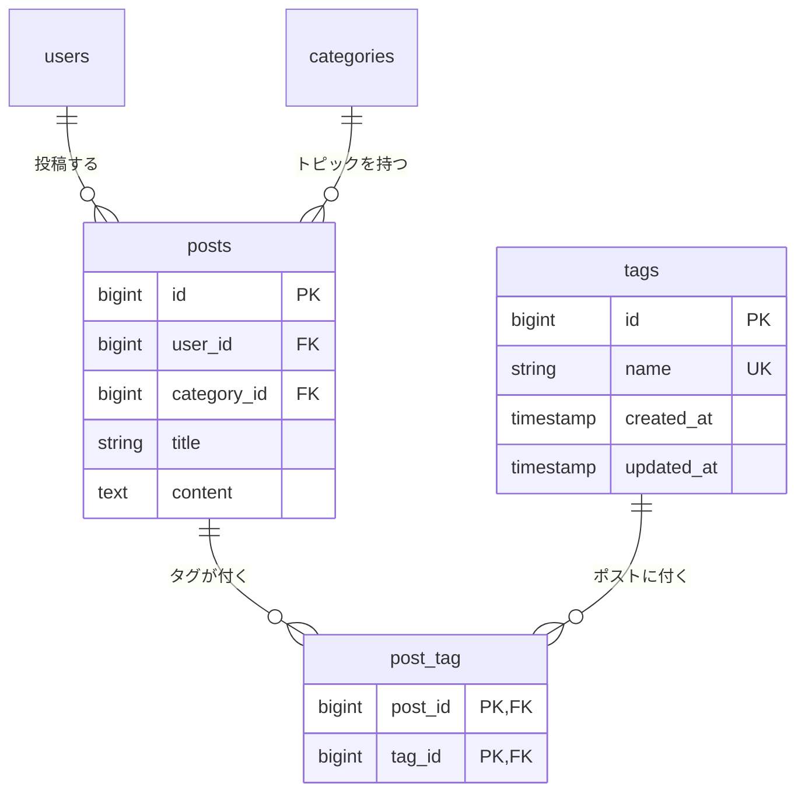
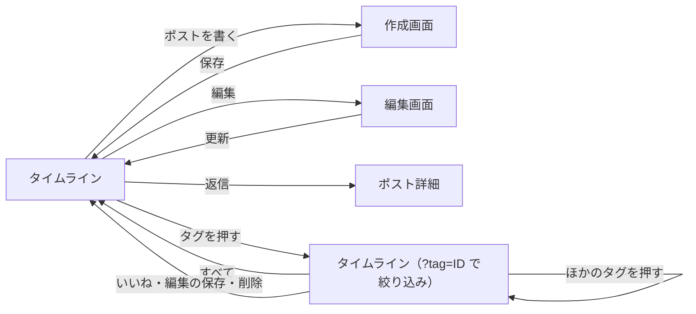

> この設計書は、この機能を実装した時点の記録です。このあとは更新していません。

# タグ機能 設計書

Issue: https://github.com/basstuba/post-app-practice/issues/10

## 概要

今のタイムラインは全ポストが新しい順に並ぶだけで、ポストが増えると読みたいものを探せない。ポストにハッシュタグを付けられるようにし、タイムラインをタグで絞り込めるようにする。

- あらかじめ用意された 5 つのタグから、ポストの作成画面・編集画面でチェックして付ける。タグを作る・消す・名前を変える画面は作らない
- タイムラインの各ポストに付いているタグを出し、タグを押すとそのタグのポストだけに絞り込む
- ポスト詳細画面には、付いているタグを表示だけする（readonly）
- タグを付け替えられるのは、そのポストを書いた本人だけ

### 決めたこと

| 項目 | 内容 |
| :--- | :--- |
| タグの数 | 1 ポストにつき 0〜複数（全 5 件まで）。1 つも付けなくても投稿・更新できる。トピックは今までどおり必須 |
| タグの名前 | `Laravel` / `雑談` / `暮らし` / `つまずき` / `質問`。トピック（お知らせ・技術メモ・雑記）とは別の「話題のキーワード」。`#` なしで保存し、画面では `#Laravel` のように `#` を付けて出す |
| タグの用意 | `TagSeeder`（新規）で入れる。名前をキーにして入れる（`firstOrCreate`）ので、繰り返し実行しても増えず、エラーにもならない。`php artisan db:seed --class=TagSeeder` で単体でも実行できる。`DatabaseSeeder` から `$this->call(TagSeeder::class)` で呼べるようにする |
| 今回のタグの入れ方 | 既存データは触らないので、`DatabaseSeeder` や `migrate:fresh` は使わず、`TagSeeder` を単体で実行して入れる |
| 既存データ | ユーザー・トピック・ポストのシーダーデータは変更しない。`DatabaseSeeder` に足すのは `TagSeeder` の呼び出し 1 行だけ。タグが付いたポストは最初は 0 件で、動作確認のときに編集画面で付ける |
| 付け替えてよい人 | そのポストを書いた本人のみ。新しい認可は作らず、既存の `PostPolicy::update` をそのまま使う（編集画面の表示も更新も同じ判定） |
| 入力欄 | 作成画面・編集画面に、タグを 5 件のチェックボックスで並べる（並びはタグの id 順）。編集画面では、今付いているタグにチェックが入る |
| 保存のしかた | 送られたタグの組に置き換える（付いていたものが外れ、新しく選んだものが付く）。全部外して保存すると 0 件になる。作成では、ポストの保存とタグの紐付けを一緒に成功・失敗させる（トランザクション） |
| 「編集済み」 | 目印の判定（`updated_at` が `created_at` より後）は変えない。タグだけを変えて保存しても「編集済み」は付かない |
| タイムラインの表示 | 各ポストの本文の下に `#タグ名` を並べる（タグの id 順）。付いていなければ並びを包む要素ごと出さない |
| ポスト詳細画面の表示 | 本文の下に `#タグ名` を表示するだけ。リンクにも入力欄にもしない。付いていなければ何も出さない |
| 絞り込み | `GET /posts?tag={タグのid}`。タイムラインの先頭に「すべて」とタグ 5 件を並べ、押すとそのタグだけで絞り込む。各ポストのタグを押しても同じ。選べるのは 1 つだけ。絞り込み中のタグは強調する |
| 絞り込み後の並び | 新しい順（`latest()`）、ページ分けなし |
| 該当なし | 絞り込んで 0 件のときは「このタグのポストはありません。」。ポストが 1 件もないときの「まだポストがありません。」とは出し分ける |
| `tag` の値が不正なとき | 存在しないタグの id、数値以外、配列（`tag[]=1`）は 404。`?tag=`（空）は指定なしと同じ扱いで、全ポストを出す |
| 保存後・削除後 | 今までどおり `posts.index`（絞り込みなし）に戻る。絞り込み中に、いいね・編集・削除をしても絞り込みは外れる（今の動きのまま） |
| ポスト・ユーザー・タグが削除されたとき | ぶら下がる `post_tag` の行も一緒に消える。タグを消してもポストは残る |
| 入力チェックの置き場所 | `PostController` の中の `validate()`。FormRequest は使わない（既存の書き方に合わせる） |
| タグの色 | タグ名ごとの色分けはしない。トピックの色つきの丸とは見た目を変え、`#` つきの文字として出す |

### 付随して行うこと(機能の範囲外)

付随して行うことは無い。入力チェックの訳の追加（下の「入力チェックとメッセージ一覧」）は、タグの入力チェックのために必要な、機能の範囲内の変更。

## 受け入れ条件

- [ ] ポストの作成画面と編集画面で、あらかじめ用意されたタグから選んで保存できる
- [ ] タイムラインのポストそれぞれに、そのポストに付いているタグが出る（1 つも付いていないポストには何も出ない）
- [ ] タイムラインでタグを 1 つ選ぶと、そのタグが付いたポストだけが並ぶ
- [ ] 他人のポストの編集画面を URL で直接開くと 403 になり、他人のポストのタグは変えられない

## 変えないもの

- タイムライン（`posts.index`）の今の動き。`?tag` がないときは、全ポストを新しい順（`latest()`）に、ページ分けなしで並べる。一覧に出る項目・並び順・リンク先もそのまま。足すのは、各ポストのタグ表示と、先頭のタグ一覧だけ
- 絞り込みは `?tag` を付けたときだけ働く。付けないタイムラインの表示対象は変えない
- 既存のシーダーデータ（ユーザー・トピック・ポスト）。`DatabaseSeeder` の変更は `TagSeeder` を呼ぶ 1 行だけ
- いいね・リプライ・ポストの削除の動きと権限。`PostPolicy` の中身も触らない
- 「編集済み」の目印の判定
- 本文 140 字・タイトル 255 字の制限、トピックの必須チェック、既存の入力チェックのメッセージ
- ポスト詳細画面のタグ以外の表示と操作（リプライの一覧・送信フォーム・削除）
- 既存のテーブル（`users` / `posts` / `categories` / `replies` / `likes`）の列。タグとの関係は新しい `post_tag` 側に持たせる
- 認証が必要なルートは、これまでどおり `auth` ミドルウェアのグループに入れる

### 言語設定による変化

言語設定は変えない。`lang/ja/validation.php` に訳を足すが、足すのは今まで訳していなかったルール（`array` / `distinct` / `integer`）と項目名（`tags`・`tags.*`）だけ。既存のメッセージの文言は変わらない。

## 増えるテーブル

`tags`（タグ）と `post_tag`（ポストとタグの中間テーブル）を足す。ポストとタグは多対多。

### ER図

`posts` は、関係の説明に必要な列だけを描いている。

### テーブルに入れる値

#### tags（タグ）

| カラム名 | データ型 | 制約 | 説明 |
| :------- | :------- | :--- | :--- |
| id | BIGINT | PRIMARY KEY, AUTO_INCREMENT | タグを 1 つずつ区別する番号 |
| name | VARCHAR(255) | NOT NULL, UNIQUE | タグの名前（`#` なし）。重複させない |
| created_at | TIMESTAMP | - | 作成日時 |
| updated_at | TIMESTAMP | - | 更新日時 |

`TagSeeder` が入れる値（この順に入れるので、空の DB では id が 1〜5 になる）:

| id | name |
| :-- | :--- |
| 1 | Laravel |
| 2 | 雑談 |
| 3 | 暮らし |
| 4 | つまずき |
| 5 | 質問 |

#### post_tag（ポストとタグの中間テーブル）

| カラム名 | データ型 | 制約 | 説明 |
| :------- | :------- | :--- | :--- |
| post_id | BIGINT | FOREIGN KEY, NOT NULL | タグが付くポスト。`posts.id` を参照し、ポストの削除と一緒に消える |
| tag_id | BIGINT | FOREIGN KEY, NOT NULL | 付いているタグ。`tags.id` を参照し、タグの削除と一緒に消える |

- `(post_id, tag_id)` の組を主キーにし、同じポストに同じタグが 2 回付かないようにする（`likes` と同じ作り）
- 中間テーブルに日時の列は持たない。タグがいつ付いたかは使わない
- タグの並びは `tags.id` の昇順

### 追加・変更されるクラス(コードはまだ書かない)

| 種類 | 名前 | 役割 |
| :--- | :--- | :--- |
| マイグレーション | `tags` の作成（新規） | `tags` テーブルを作る |
| マイグレーション | `post_tag` の作成（新規） | 中間テーブルを作る（`cascadeOnDelete`、複合主キー） |
| モデル | `Tag`（新規） | `posts()` を `belongsToMany` で持つ。`name` を一括代入できる |
| モデル | `Post`（変更） | `tags()` を `belongsToMany` で足す（`tags.id` 順） |
| ファクトリー | `TagFactory`（新規） | テスト用のタグを作る。`name` は重ならない値にする |
| シーダー | `TagSeeder`（新規） | 5 件のタグを、名前をキーに入れる |
| シーダー | `DatabaseSeeder`（変更） | `TagSeeder` を呼ぶ 1 行を足す。ほかは触らない |
| コントローラー | `PostController`（変更） | `index`: `?tag` の絞り込みと、タグの先読み／`create`・`edit`: タグ一覧を渡す／`store`・`update`: タグの入力チェックと保存／`show`: タグを読み込む |
| 言語ファイル | `lang/ja/validation.php`（変更） | `array` / `distinct` / `integer` の訳と、項目名 `tags`・`tags.*`（タグ）を足す |
| ポリシー | `PostPolicy`（変更なし） | 既存の `update` をそのまま使う |

ビュー（`posts/index` / `create` / `edit` / `show`）の変更は「増える画面」に書く。

## 増える画面

新しく増える画面は無い。既存の 4 つの画面にタグの表示・入力を足す。

### 既存画面の変更(新しい画面ではない)

| 画面 | 変更 |
| :--- | :--- |
| タイムライン（`posts.index`） | ①先頭に、タグの絞り込み（「すべて」と `#タグ名` ×5）を置く。絞り込み中のタグは強調する（`aria-current`）。②各ポストの本文の下に、付いているタグを `#タグ名` で並べる（押すと絞り込み）。付いていなければ並びを包む要素（`post-tags`）ごと出さない。③絞り込みで 0 件のとき「このタグのポストはありません。」を出す |
| ポストを書く（`posts.create`） | 本文の下に「タグ」のチェックボックス 5 件を足す。エラーで戻ったとき、選んでいたタグのチェックを残す。タグのエラーはチェックボックス群の下に出す |
| ポストを編集（`posts.edit`） | 同じチェックボックスを足し、今付いているタグにチェックを入れる。エラーで戻ったときは、入力済みのチェックの状態を優先する（全部外してエラーになった場合も、元のタグを復活させない） |
| ポスト詳細（`posts.show`） | 本文の下に、付いているタグを `#タグ名` で表示するだけ。リンクにも入力欄にもしない。付いていなければ何も出さない |

### 画面遷移

- 作成・更新・いいね・削除のあとは、今までどおり絞り込みなしのタイムラインに戻る
- ポスト詳細のタグは表示だけで、ここから絞り込みへは移れない

### ルート

新しいルートは無い。既存のルートの受け取る値が増える。

| 操作 | メソッドとURL | 名前 | 変更点 |
| :--- | :------------ | :--- | :----- |
| タイムライン | GET /posts | `posts.index` | `?tag={id}` で絞り込む。不正な値は 404 |
| 作成画面 | GET /posts/create | `posts.create` | タグ一覧を渡す |
| 作成 | POST /posts | `posts.store` | `tags[]` を受け取る |
| ポスト詳細 | GET /posts/{post} | `posts.show` | タグを読み込む |
| 編集画面 | GET /posts/{post}/edit | `posts.edit` | タグ一覧を渡す。他人は 403（今までどおり） |
| 更新 | PUT /posts/{post} | `posts.update` | `tags[]` を受け取る。他人は 403（今までどおり） |

## 入力チェックとメッセージ一覧

### 入力チェック

| 画面 | 項目 | 必須 | 内容 | 備考 |
| :--- | :--- | :--- | :--- | :--- |
| 作成・編集 | タグ（`tags`） | 任意 | 配列。各要素は整数・重複なし・`tags` テーブルに存在する id | 送られなければ（全部外した場合も）0 件として扱う |
| タイムライン | `tag`（クエリ） | 任意 | 存在するタグの id 1 つ | 満たさない場合は入力エラーではなく 404。空は指定なし |

- 作成・更新は、ログインしていなければ入力チェックより前にログイン画面へ送る
- 更新は、認可（本人かどうか）を入力チェックより先に行う。他人のポストへの更新は、タグの内容にかかわらず 403 で、タグは変わらない
- 画面（チェックボックス）からは存在する id しか送られない。以下のエラーは、URL の書き換えや手書きの送信でだけ出る

### メッセージ一覧

| 画面 | でる場面 | 区分 | メッセージ |
| :--- | :------- | :--- | :--------- |
| 作成・編集 | 存在しないタグの id が送られた | エラー | 選択されたタグは正しくありません。 |
| 作成・編集 | 同じタグが 2 回送られた | エラー | タグが重複しています。 |
| 作成・編集 | タグが配列でない（`tags=1` など） | エラー | タグの形式が正しくありません。 |
| 作成・編集 | タグの要素が整数でない（`tags[]=abc`、入れ子の配列など） | エラー | タグは整数で入力してください。 |
| タイムライン | タグで絞り込んで 0 件 | 案内 | このタグのポストはありません。 |
| タイムライン | 存在しないタグ・数値以外・配列を `?tag` に指定した | エラー(404画面) | Laravel 既定の 404 画面（文言は英語のまま） |
| 編集画面・更新 | 他人のポストの編集画面を開く・更新する | エラー(403画面) | Laravel 既定の 403 画面（文言は英語のまま） |

- 「選択された〜は正しくありません。」は既存の `exists` の訳を使う。`array`・`distinct`・`integer` は今まで訳していなかったので、`lang/ja/validation.php` に次の文言を足す
  - `array`: `:attributeの形式が正しくありません。`
  - `distinct`: `:attributeが重複しています。`
  - `integer`: `:attributeは整数で入力してください。`
- 項目名は `tags` と `tags.*` の両方を「タグ」にする。翻訳キー（`validation.xxx`）が画面にそのまま出ないようにする
- エラーは、既存の入力欄と同じく赤字で、チェックボックス群の下に出す。`tags` と `tags.*` のエラーはまとめてそこに出す
- 成功したときのメッセージは出さない。タイムラインにタグが出ること自体が結果の確認になる
- 403・404 の画面は `ja.json` を作っていないので英語のまま（今回は訳さない）

## テスト観点

Feature テストで確認する。ファイルは `tests/Feature/TagTest.php`。DB を使うので `RefreshDatabase` を使い、データは Factory（`TagFactory` を新設）で作る。シーダーの確認は `$this->seed(TagSeeder::class)` と `$this->seed()` で行う。

### 受け入れ条件に対応するもの

| # | 観点 | 期待する結果 |
| :-- | :--- | :----------- |
| 1 | 作成画面を開く | タグ 5 件（`#` なしの名前）がチェックボックスで並ぶ |
| 2 | 作成画面でタグを 2 つ選んで保存する | ポストが作られ、`post_tag` に選んだ 2 件だけが入る。タイムラインに戻る |
| 3 | 編集画面を開く（タグ 2 つが付いたポスト） | 付いている 2 つにチェックが入り、ほかは入っていない |
| 4 | 編集画面でタグを付け替えて保存する | 外したタグは消え、新しく選んだタグが付く。タイムラインに戻る |
| 5 | タイムラインを開く（タグが付いたポスト） | そのポストに `#タグ名` が出る |
| 6 | タイムラインを開く（タグが 1 つも付いていないポストだけ） | タグの並びの要素（`post-tags`）が出ない |
| 7 | `?tag={id}` で絞り込む | そのタグが付いたポストだけが並び、付いていないポストは出ない。新しい順 |
| 8 | 他人のポストの編集画面を開く | 403 になる |
| 9 | 他人のポストを、タグを変える内容で更新する | 403 になり、タグ・タイトル・本文は元のまま |

### 境界・認可・その他

| # | 観点 | 期待する結果 |
| :-- | :--- | :----------- |
| 10 | タグを 1 つも選ばずにポストを作る | 作れる。`post_tag` は増えない |
| 11 | 5 件すべて選んで保存する | 5 件とも付く |
| 12 | 編集画面でタグを全部外して保存する | タグが 0 件になる。外したタグそのものは `tags` に残る |
| 13 | 存在しないタグの id を送って作成・更新する | 「選択されたタグは正しくありません。」が出て、ポストは増えず、更新前の値のまま。`post_tag` も変わらない |
| 14 | 同じタグを 2 回送る | 「タグが重複しています。」が出て、保存されない |
| 15 | `tags` に配列でない値・文字列・入れ子の配列を送る | 500 にならず、日本語のエラー（「タグの形式が正しくありません。」または「タグは整数で入力してください。」）が出て、保存されない |
| 16 | エラーで戻った作成画面 | 入力したタイトル・本文と、選んでいたタグのチェックが残る |
| 17 | 編集画面でタグを全部外し、ほかの項目でエラーにして戻る | チェックなしのまま（元のタグが復活しない）。エラーメッセージも出る |
| 18 | 未ログインで作成・保存・編集・更新・`?tag` つきのタイムラインにアクセスする | ログイン画面へ送られ、DB は変わらない |
| 19 | タイムラインの先頭 | 「すべて」とタグ 5 件が並ぶ。「すべて」は `?tag` なしの URL、各タグは `?tag={id}` の URL へのリンク |
| 20 | 絞り込み中 | 選んでいるタグが強調される（`aria-current`）。ほかのポストのタグ表示は `#名前` のまま |
| 21 | 各ポストのタグのリンク | 押す先が `?tag={id}` の URL になっている |
| 22 | 絞り込んで 0 件になるタグを指定する | 「このタグのポストはありません。」が出て、「まだポストがありません。」は出ない |
| 23 | 存在しない id・数値以外・配列を `?tag` に指定する | 404 になり、500 にならない |
| 24 | `?tag=`（空）で開く | 絞り込みなしで、全ポストが並ぶ |
| 25 | ポスト詳細画面（タグが付いたポスト） | `#タグ名` が表示される。他人のポストでも見える |
| 26 | ポスト詳細画面（タグなし） | タグの要素が出ない |
| 27 | ポスト詳細画面のタグの見た目 | リンクではなく、タグの入力欄（`name="tags[]"`）も無い |
| 28 | タグだけを変えて更新する | 「編集済み」は付かない（`updated_at` は動かない）。タイトルや本文も変えたときは今までどおり付く |
| 29 | ポストを削除する | そのポストの `post_tag` の行が消え、`tags` は残る |
| 30 | ユーザーを削除する | そのユーザーのポストと `post_tag` の行が消える |
| 31 | タグを削除する | そのタグの `post_tag` の行が消え、ポストは残る |
| 32 | `TagSeeder` を単体で実行する | `tags` に 5 件（名前が仕様どおり）だけが入る。ユーザー・トピック・ポストは増えない |
| 33 | `TagSeeder` を 2 回実行する | 5 件のまま。エラーにならない |
| 34 | `DatabaseSeeder` を実行する | タグが 5 件入り、`post_tag` は 0 件。ユーザー・トピック・ポストの件数と内容は、今までと同じ |
| 35 | タグのエラーの画面 | 日本語で出る。`validation.` のような翻訳キーがそのまま出ない |

### 既存の動きが変わっていないことの確認

| # | 観点 | 期待する結果 |
| :-- | :--- | :----------- |
| 36 | `?tag` なしのタイムライン | 全ポストが新しい順に並ぶ。ページ分けはない。タイトル・本文・トピック・「編集済み」・返信リンクの href（`posts.show`）が今までどおり出る |
| 37 | 他人のポストのタイムライン | 編集・削除が出ない（今までどおり）。いいねのボタンと数も出る |
| 38 | 絞り込み中のタイムライン | 自分のポストにだけ編集・削除が出て、いいねのボタンの状態も同じ（絞り込みの有無で出方が変わらない） |
| 39 | タグを付けずにポストを作る（今までの操作） | 今までどおり作れる。トピックの必須チェック、タイトル 255 字・本文 140 字の境界と文言も変わらない |
| 40 | 編集で、タイトル・本文・トピックを更新する | 今までどおり更新でき、「編集済み」が付く |
| 41 | 他人のポストの編集・削除 | 今までどおり 403 |
| 42 | ポスト詳細画面 | リプライの一覧・送信・削除は、今までどおり動く |
| 43 | 既存のテストをすべて流す | すべて通る |
